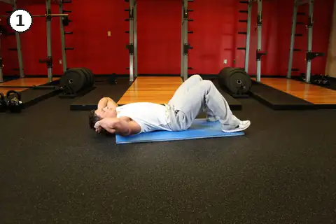

# Crunches

> Füße am Boden, Schulterblätter nur leicht abheben, Rippen Richtung Becken. Nicht am Kopf ziehen.

- **Muskeln/Bereich:** Gerade Bauchmuskeln
- **Equipment:** Körpergewicht
- **Kategorie:** Core
- **Erfassung:** Körpergewicht, Wiederholungen
