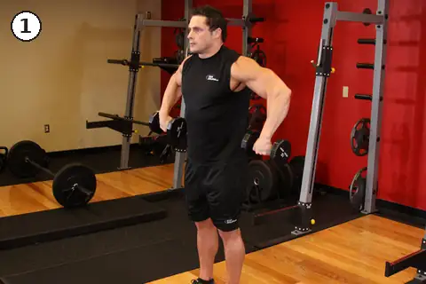

# Cuban Press

> Aufrecht rudern bis Oberarme waagerecht, Unterarme nach oben drehen, dann über Kopf drücken. Sehr leicht, für gesunde Schultern.

- **Muskeln/Bereich:** Rotatorenmanschette, Schultern
- **Equipment:** Kurzhanteln
- **Kategorie:** Schultern
- **Erfassung:** Gewicht und Wiederholungen, Steigerung 1 kg
- **Hantel:** zwei Kurzhanteln
