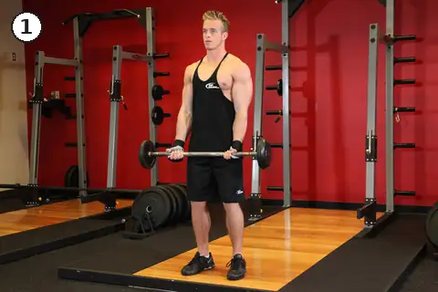

# Curls

> Ellbogen bleiben am Körper.

- **Muskeln/Bereich:** Bizeps
- **Equipment:** SZ-Stange
- **Kategorie:** Arme
- **Erfassung:** Gewicht und Wiederholungen, Steigerung 2.5 kg
- **Hantel:** SZ-Stange

## Ausführung

- Aufrecht, Ellbogen am Körper.
- Stange kontrolliert hochbeugen, Handgelenke gerade.
- Oben kurz anspannen, langsam ablassen.

## Häufige Fehler

- Schwung mit dem Oberkörper.
- Ellbogen wandern nach vorn.

## Atmung

Ausatmen beim Hochbeugen.

## Wo du es spürst

Bizeps.

## Kommt vor in

- [Kraft B · Beine](../ablaeufe/kraft-b.md)
- [Vorlage Arme und Schultern](../ablaeufe/vorlagen/x-arms.md)
