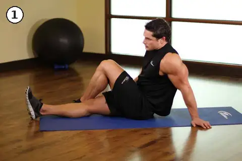

# Tänzer-Drehung liegend

> Rückenlage, ein Knie über den Körper zur Gegenseite legen, Blick zur anderen Seite.

- **Muskeln/Bereich:** Rücken, Po
- **Equipment:** Körpergewicht
- **Kategorie:** Mobility
- **Erfassung:** Sekunden (Halten)

## Kommt vor in

- [Mobility nach Gefühl: Unterer Rücken](../mobility/koerperbereiche.md)
