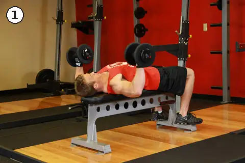

# Bankdrücken

> Ellbogen ca. 45° zum Körper, Füße fest am Boden.

- **Muskeln/Bereich:** Brust, Trizeps
- **Equipment:** Kurzhanteln, Bank
- **Kategorie:** Brust
- **Erfassung:** Gewicht und Wiederholungen, Steigerung 1 kg
- **Hantel:** zwei Kurzhanteln

## Ausführung

- Füße fest am Boden, Schulterblätter zusammen und nach unten.
- Leichtes natürliches Hohlkreuz, Po bleibt auf der Bank.
- Hanteln über der Brust, Unterarme senkrecht.
- Ellbogen ca. 45° zum Körper absenken, bis die Hanteln neben der Brust sind.
- Kraftvoll hochdrücken, oben nicht zusammenschlagen.

## Häufige Fehler

- Ellbogen 90° zur Seite: belastet die Schulter.
- Schulterblätter lösen sich beim Drücken.

## Atmung

Einatmen beim Absenken, ausatmen beim Drücken.

## Wo du es spürst

Brust und Trizeps.

## Kommt vor in

- [Kraft A](../ablaeufe/kraft-a.md)
- [Vorlage Oberkörper Drücken](../ablaeufe/vorlagen/x-push.md)
- [Skill Kurzhantel-Bankdrücken, Stufe 1](../skills/bankdr.md)
- [Skill Kurzhantel-Bankdrücken, Stufe 2](../skills/bankdr.md)
- [Skill Kurzhantel-Bankdrücken, Stufe 3](../skills/bankdr.md)
- [Skill Kurzhantel-Bankdrücken, Stufe 4](../skills/bankdr.md)
