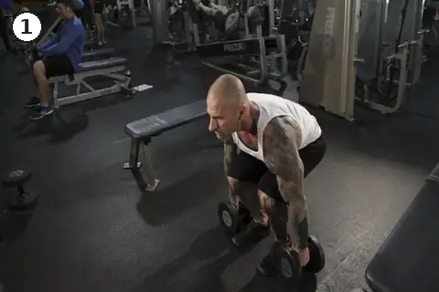

# Umsetzen mit Kurzhanteln

> Hanteln vom Knie explosiv hochreißen, Hüfte strecken, auf den Schultern fangen.

- **Muskeln/Bereich:** Ganzkörper, Schnellkraft
- **Equipment:** Kurzhanteln
- **Kategorie:** Ganzkörper
- **Erfassung:** Gewicht und Wiederholungen, Steigerung 1 kg
- **Hantel:** zwei Kurzhanteln
