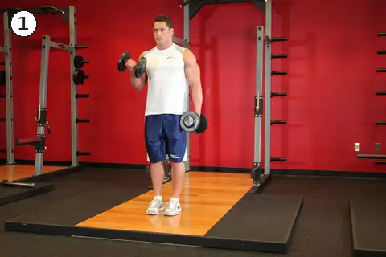

# Kurzhantel-Curls im Wechsel

> Handfläche dreht beim Hochheben nach oben, Ellbogen bleibt am Körper.

- **Muskeln/Bereich:** Bizeps
- **Equipment:** Kurzhanteln
- **Kategorie:** Arme
- **Erfassung:** Gewicht und Wiederholungen, Steigerung 1 kg
- **Hantel:** zwei Kurzhanteln
