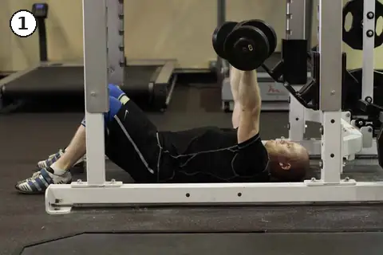

# Bodendrücken Kurzhanteln

> Am Boden liegend, Oberarme berühren kurz den Boden, dann drücken. Schont die Schultern.

- **Muskeln/Bereich:** Brust, Trizeps
- **Equipment:** Kurzhanteln
- **Kategorie:** Brust
- **Erfassung:** Gewicht und Wiederholungen, Steigerung 1 kg
- **Hantel:** zwei Kurzhanteln
