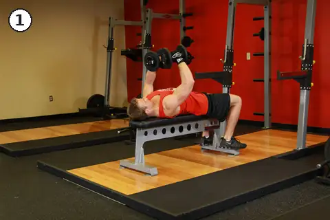

# Fliegende auf der Bank

> Arme leicht gebeugt, in einem Bogen bis zur Dehnung in der Brust öffnen. Leichter als beim Drücken.

- **Muskeln/Bereich:** Brust
- **Equipment:** Kurzhanteln, Bank
- **Kategorie:** Brust
- **Erfassung:** Gewicht und Wiederholungen, Steigerung 1 kg
- **Hantel:** zwei Kurzhanteln

## Kommt vor in

- [Vorlage Oberkörper Drücken](../ablaeufe/vorlagen/x-push.md)
- [Skill Kurzhantel-Bankdrücken, Stufe 1](../skills/bankdr.md)
