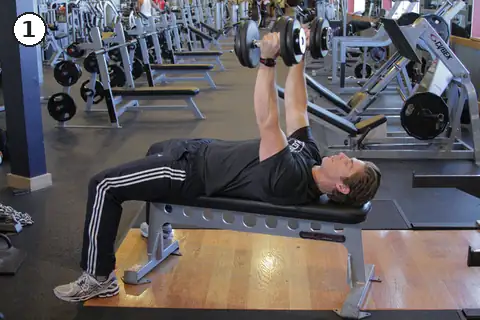

# Bankdrücken Neutralgriff

> Handflächen zeigen zueinander, Ellbogen nah am Körper. Schulterfreundlich.

- **Muskeln/Bereich:** Brust, Trizeps
- **Equipment:** Kurzhanteln, Bank
- **Kategorie:** Brust
- **Erfassung:** Gewicht und Wiederholungen, Steigerung 1 kg
- **Hantel:** zwei Kurzhanteln
