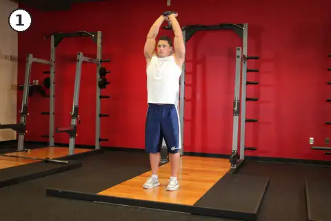

# Überkopf-Trizepsstrecken

> Eine Hantel mit beiden Händen hinter dem Kopf, Ellbogen eng, nach oben strecken.

- **Muskeln/Bereich:** Trizeps (langer Kopf)
- **Equipment:** Kurzhanteln
- **Kategorie:** Arme
- **Erfassung:** Gewicht und Wiederholungen, Steigerung 2 kg

## Kommt vor in

- [Vorlage Arme und Schultern](../ablaeufe/vorlagen/x-arms.md)
