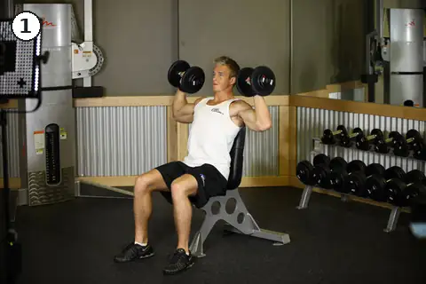

# Schulterdrücken Kurzhanteln

> Aufrecht auf der Bank oder im Stand. Hanteln von Schulterhöhe nach oben drücken, Rippen bleiben unten.

- **Muskeln/Bereich:** Schultern, Trizeps
- **Equipment:** Kurzhanteln, Bank
- **Kategorie:** Schultern
- **Erfassung:** Gewicht und Wiederholungen, Steigerung 1 kg
- **Hantel:** zwei Kurzhanteln

## Kommt vor in

- [Vorlage Oberkörper Drücken](../ablaeufe/vorlagen/x-push.md)
- [Skill Handstand-Liegestütz, Stufe 2](../skills/hspu.md)
- [Skill Überkopfdrücken, Stufe 1](../skills/ohp.md)
