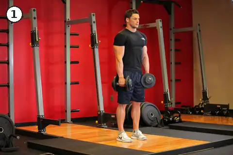

# Rumänisches Kreuzheben Kurzhanteln

> Hanteln vor den Oberschenkeln, Hüfte nach hinten schieben, Rücken gerade, Dehnung in den Beinbeugern.

- **Muskeln/Bereich:** Beinbeuger, Po
- **Equipment:** Kurzhanteln
- **Kategorie:** Beine und Po
- **Erfassung:** Gewicht und Wiederholungen, Steigerung 1 kg
- **Hantel:** zwei Kurzhanteln

## Kommt vor in

- [Vorlage Beine und Po](../ablaeufe/vorlagen/x-legs.md)
