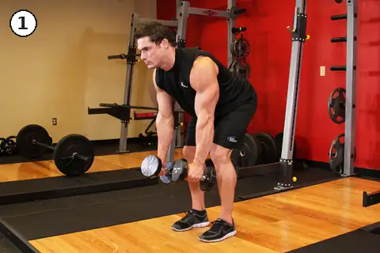

# Rudern vorgebeugt beidarmig

> Oberkörper ca. 45° vorgebeugt, beide Hanteln zur Hüfte ziehen, Schulterblätter zusammen.

- **Muskeln/Bereich:** Rücken
- **Equipment:** Kurzhanteln
- **Kategorie:** Rücken
- **Erfassung:** Gewicht und Wiederholungen, Steigerung 1 kg
- **Hantel:** zwei Kurzhanteln
