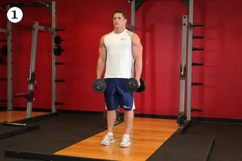

# Shrugs mit Kurzhanteln

> Schultern gerade hoch zu den Ohren, oben 1 s halten.

- **Muskeln/Bereich:** Nacken, Trapez
- **Equipment:** Kurzhanteln
- **Kategorie:** Schultern
- **Erfassung:** Gewicht und Wiederholungen, Steigerung 1 kg
- **Hantel:** zwei Kurzhanteln
