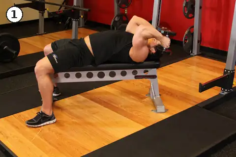

# French Press Kurzhanteln

> Auf der Bank, Handflächen zueinander, Hanteln neben den Kopf senken. Oberarme bleiben ruhig.

- **Muskeln/Bereich:** Trizeps
- **Equipment:** Kurzhanteln, Bank
- **Kategorie:** Arme
- **Erfassung:** Gewicht und Wiederholungen, Steigerung 1 kg
- **Hantel:** zwei Kurzhanteln
