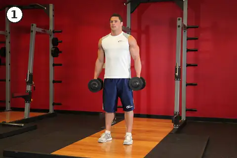

# Kniebeuge mit Kurzhanteln

> Hanteln seitlich hängen lassen, Brust hoch, tief beugen. Gute Kniebeuge ohne Ablage.

- **Muskeln/Bereich:** Oberschenkel, Po
- **Equipment:** Kurzhanteln
- **Kategorie:** Beine und Po
- **Erfassung:** Gewicht und Wiederholungen, Steigerung 1 kg
- **Hantel:** zwei Kurzhanteln
