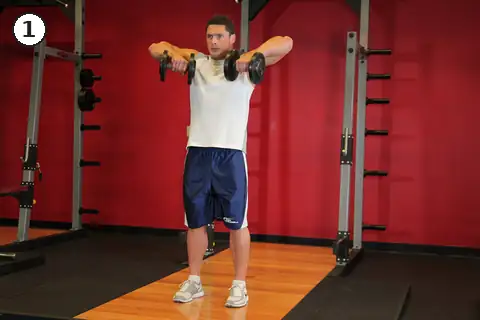

# Aufrechtes Rudern Kurzhanteln

> Hanteln am Körper bis Brusthöhe ziehen, Ellbogen führen und bleiben über den Händen.

- **Muskeln/Bereich:** Schultern, Trapez
- **Equipment:** Kurzhanteln
- **Kategorie:** Schultern
- **Erfassung:** Gewicht und Wiederholungen, Steigerung 1 kg
- **Hantel:** zwei Kurzhanteln
