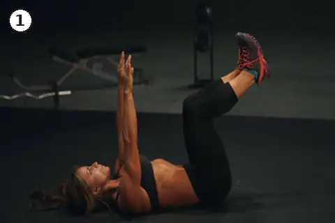

# Dead Bug

> Unterer Rücken bleibt am Boden, Gegenarm und -bein langsam strecken.

- **Muskeln/Bereich:** Core
- **Equipment:** Körpergewicht
- **Kategorie:** Core
- **Erfassung:** Sekunden (Halten)

## Ausführung

- Rückenlage, Arme zur Decke, Knie und Hüfte 90°.
- Unterer Rücken drückt sanft in den Boden.
- Gegenarm und -bein langsam strecken, knapp über dem Boden stoppen.
- Zurück zur Mitte, dann Seite wechseln.

## Häufige Fehler

- Der untere Rücken hebt ab.
- Zu schnell und mit Schwung.

## Atmung

Lang ausatmen, während du streckst.

## Wo du es spürst

Tiefe Bauchspannung.

## Kommt vor in

- [Vorlage Core Stabilität](../ablaeufe/vorlagen/x-core1.md)
- [Einstieg](../ablaeufe/gefuehrt/warmup.md)
- [Kondition + Core-Zirkel](../ablaeufe/gefuehrt/circuit.md)
