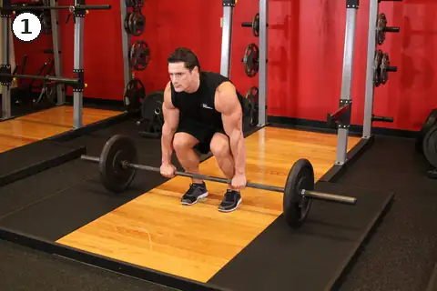

# Kreuzheben

> Stange über der Fußmitte, Lat anspannen, Boden wegdrücken.

- **Muskeln/Bereich:** Po, Beinbeuger, Rücken
- **Equipment:** Langhantel
- **Kategorie:** Beine und Po
- **Erfassung:** Gewicht und Wiederholungen, Steigerung 2.5 kg
- **Hantel:** Langhantel

## Ausführung

- Füße hüftbreit, Stange über der Fußmitte, etwa 3 cm vor dem Schienbein.
- Griff knapp außerhalb der Beine, Arme senkrecht.
- Schienbeine an die Stange, Brust hoch, Rücken neutral.
- Lat anspannen: Achseln zu den Hosentaschen.
- Boden wegdrücken, Stange bleibt am Bein, oben Hüfte strecken und Po anspannen.

## Häufige Fehler

- Hüfte schießt zuerst hoch, der Rücken macht die Arbeit.
- Stange entfernt sich vom Körper.
- Oben nach hinten überstrecken.

## Atmung

Unten tief einatmen und den Bauch fest machen, oben ausatmen.

## Wo du es spürst

Beine und Po drücken, der Rücken hält nur.

## Kommt vor in

- [Kraft A](../ablaeufe/kraft-a.md)
- [Skill Kreuzheben, Stufe 1](../skills/kreuzheben.md)
- [Skill Kreuzheben, Stufe 2](../skills/kreuzheben.md)
- [Skill Kreuzheben, Stufe 3](../skills/kreuzheben.md)
- [Skill Kreuzheben, Stufe 4](../skills/kreuzheben.md)
- [Skill Kreuzheben, Stufe 5](../skills/kreuzheben.md)
- [Skill Umsetzen (Power Clean), Stufe 3](../skills/umsetzen.md)
