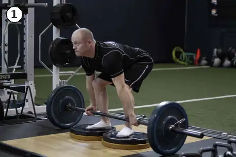

# Defizit-Kreuzheben

> Auf einer Scheibe (2–5 cm) stehen, dadurch längerer Weg. Gleiche Technik wie Kreuzheben, 10–20 % weniger Gewicht.

- **Muskeln/Bereich:** Po, Beinbeuger, Rücken, Start vom Boden
- **Equipment:** Langhantel
- **Kategorie:** Beine und Po
- **Erfassung:** Gewicht und Wiederholungen, Steigerung 2.5 kg
- **Hantel:** Langhantel
