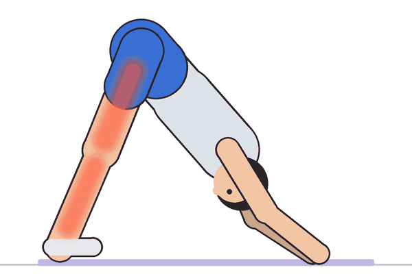

# Herabschauender Hund

> Hüfte hoch und nach hinten, Rücken lang. Knie dürfen gebeugt sein, Fersen abwechselnd zum Boden.

- **Muskeln/Bereich:** Waden, Beinbeuger, Schultern
- **Equipment:** Körpergewicht
- **Kategorie:** Mobility
- **Erfassung:** Sekunden (Halten)

## Ausführung

- Hände schulterbreit, Finger weit, Druck über Zeigefinger und Daumenballen.
- Hüfte nach hinten oben schieben, als zöge jemand am Becken.
- Rücken lang machen hat Vorrang: Knie dürfen deutlich gebeugt sein.
- Oberarme drehen leicht nach außen, Schulterblätter breit.
- Kopf hängt locker zwischen den Oberarmen, Ohren auf Höhe der Arme.
- Fersen abwechselnd Richtung Boden treten.

## Häufige Fehler

- Runder Rücken mit gestreckten Knien.
- Schultern ziehen zu den Ohren.
- Gewicht nur auf den Handballen, das Handgelenk wird überlastet.

## Atmung

Lang und gleichmäßig durch die Nase. Ausatmen: Hüfte weiter nach hinten.

## Wo du es spürst

Ziehen in Waden und Beinrückseite, Streckung in Schultern und Flanken.

## Kommt vor in

- [Yoga · 30 min](../ablaeufe/gefuehrt/yoga30.md)
- [Mobility-Routine](../ablaeufe/gefuehrt/mob.md)
- [Mobility nach Gefühl: Schultern und Brust](../mobility/koerperbereiche.md)
- [Mobility nach Gefühl: Oberschenkel hinten](../mobility/koerperbereiche.md)
- [Mobility nach Gefühl: Waden und Sprunggelenk](../mobility/koerperbereiche.md)
- [Yoga nach Gefühl](../mobility/yoga-baukasten.md)
- [Skill Vorbeuge, Stufe 1](../skills/vorbeuge.md)
- [Skill Schulterbeweglichkeit, Stufe 4](../skills/schulter.md)
