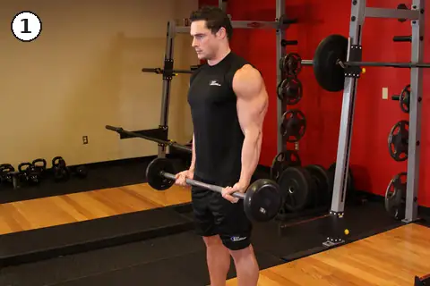

# Drag Curls

> Stange eng am Körper nach oben schleifen, Ellbogen wandern nach hinten.

- **Muskeln/Bereich:** Bizeps
- **Equipment:** SZ-Stange
- **Kategorie:** Arme
- **Erfassung:** Gewicht und Wiederholungen, Steigerung 2.5 kg
- **Hantel:** SZ-Stange

## Kommt vor in

- [Vorlage Oberkörper Ziehen](../ablaeufe/vorlagen/x-pull.md)
