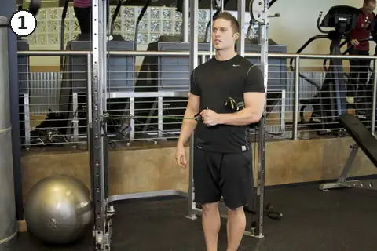

# Außenrotation mit Band

> Ellbogen am Körper, 90° gebeugt, Unterarm nach außen drehen. Leicht, für gesunde Schultern.

- **Muskeln/Bereich:** Rotatorenmanschette
- **Equipment:** Bänder
- **Kategorie:** Schultern
- **Erfassung:** Band, Wiederholungen
- **Pro Seite** ausführen

## Kommt vor in

- [Skill Schulterbeweglichkeit, Stufe 1](../skills/schulter.md)
