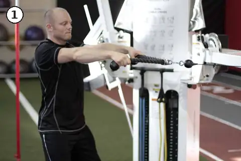

# Face Pulls

*Hinweis zum Foto: Foto am Kabelzug, mit Band gleich.*

> Band auf Kopfhöhe, Hände neben die Ohren ziehen.

- **Muskeln/Bereich:** Hintere Schulter
- **Equipment:** Bänder
- **Kategorie:** Schultern
- **Erfassung:** Band, Wiederholungen

## Ausführung

- Band auf Kopfhöhe.
- Ellbogen hoch, Hände Richtung Ohren ziehen.
- Am Ende Daumen nach hinten drehen.

## Häufige Fehler

- Mit dem Oberkörper lehnen.

## Atmung

Ausatmen beim Ziehen.

## Wo du es spürst

Hintere Schulter.

## Kommt vor in

- [Kraft C](../ablaeufe/kraft-c.md)
- [Vorlage Oberkörper Ziehen](../ablaeufe/vorlagen/x-pull.md)
