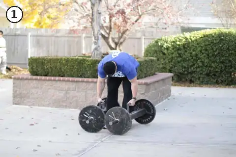

# Farmer's Walk

> Schwere Hanteln, Schultern unten, aufrecht zügig gehen. Geht auch im Kreis im Zimmer.

- **Muskeln/Bereich:** Griff, Core, Trapez
- **Equipment:** Kurzhanteln
- **Kategorie:** Core
- **Erfassung:** Gewicht und Meter, Steigerung 1 kg
- **Hantel:** zwei Kurzhanteln

## Kommt vor in

- [Vorlage Landmine und Unkonventionell](../ablaeufe/vorlagen/x-land.md)
- [Skill Kreuzheben, Stufe 3](../skills/kreuzheben.md)
- [Skill Griffkraft, Stufe 1](../skills/griff.md)
