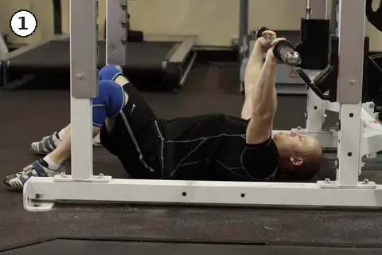

# Bodendrücken (Floor Press)

> Am Boden liegend, Stange über die Oberschenkel hochrollen. Ellbogen berühren kurz den Boden. Sicher ohne Ablage.

- **Muskeln/Bereich:** Brust, Trizeps
- **Equipment:** Langhantel
- **Kategorie:** Brust
- **Erfassung:** Gewicht und Wiederholungen, Steigerung 2.5 kg
- **Hantel:** Langhantel

## Kommt vor in

- [Vorlage Langhantel kompakt](../ablaeufe/vorlagen/x-lh.md)
- [Skill Kurzhantel-Bankdrücken, Stufe 2](../skills/bankdr.md)
