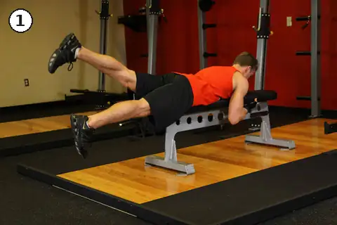

# Flutter Kicks

> Rückenlage, unterer Rücken am Boden, gestreckte Beine knapp über dem Boden klein auf und ab.

- **Muskeln/Bereich:** Core (unten)
- **Equipment:** Körpergewicht
- **Kategorie:** Core
- **Erfassung:** Sekunden (Halten)
