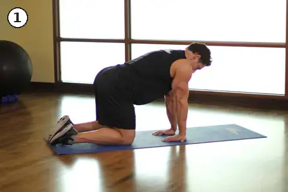

# Unterarm-Dehnung kniend

> Kniend, Handflächen mit Fingern zu den Knien auf den Boden, Po langsam nach hinten.

- **Muskeln/Bereich:** Unterarme, Handgelenke
- **Equipment:** Körpergewicht
- **Kategorie:** Mobility
- **Erfassung:** Sekunden (Halten)
