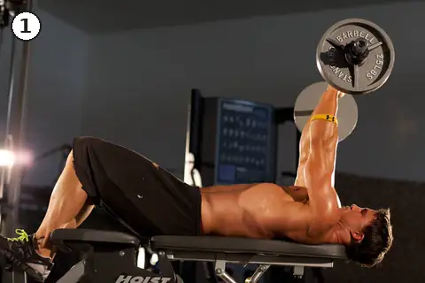

# French Press

> Ellbogen zeigen nach oben.

- **Muskeln/Bereich:** Trizeps
- **Equipment:** SZ-Stange, Bank
- **Kategorie:** Arme
- **Erfassung:** Gewicht und Wiederholungen, Steigerung 2.5 kg
- **Hantel:** SZ-Stange

## Ausführung

- Auf der Bank liegend, Oberarme senkrecht.
- Ellbogen zeigen zur Decke und bleiben eng.
- Stange Richtung Stirn oder knapp dahinter absenken.
- Nur aus dem Ellbogen strecken.

## Häufige Fehler

- Ellbogen gehen nach außen.
- Oberarme bewegen mit.

## Atmung

Ausatmen beim Strecken.

## Wo du es spürst

Trizeps.

## Kommt vor in

- [Vorlage Arme und Schultern](../ablaeufe/vorlagen/x-arms.md)
