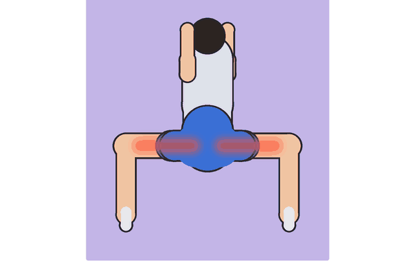

# Frosch

> Knie weit auseinander, Unterschenkel parallel, auf den Unterarmen. Hüfte langsam nach hinten schieben.

- **Muskeln/Bereich:** Oberschenkel innen
- **Equipment:** Körpergewicht
- **Kategorie:** Mobility
- **Erfassung:** Sekunden (Halten)

## Ausführung

- Vierfüßlerstand, Knie weit auseinander auf weicher Unterlage.
- Unterschenkel parallel, Sprunggelenke auf Höhe der Knie, Füße zeigen nach außen.
- Auf die Unterarme gehen, Rücken neutral, Bauch leicht aktiv.
- Hüfte langsam nach hinten schieben, bis es innen zieht, dann halten.

## Häufige Fehler

- Rücken hängt ins Hohlkreuz durch.
- Zu weit auf einmal: Knie und Leiste reagieren empfindlich.

## Atmung

Ruhig weiteratmen, beim Ausatmen Hüfte minimal nach hinten.

## Wo du es spürst

Innenseite der Oberschenkel bis zur Leiste.

## Kommt vor in

- [Yoga · 30 min](../ablaeufe/gefuehrt/yoga30.md)
- [Mobility nach Gefühl: Leiste und Innenseite](../mobility/koerperbereiche.md)
- [Yoga nach Gefühl](../mobility/yoga-baukasten.md)
- [Skill Tiefe Hocke, Stufe 2](../skills/hocke.md)
- [Skill Mittelspagat, Stufe 1](../skills/mittelspagat.md)
