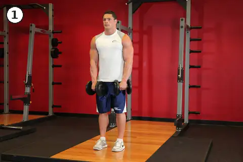

# Frontheben Kurzhanteln

> Arme fast gestreckt bis Augenhöhe heben, langsam ablassen, kein Schwung.

- **Muskeln/Bereich:** Schultern vorn
- **Equipment:** Kurzhanteln
- **Kategorie:** Schultern
- **Erfassung:** Gewicht und Wiederholungen, Steigerung 1 kg
- **Hantel:** zwei Kurzhanteln
