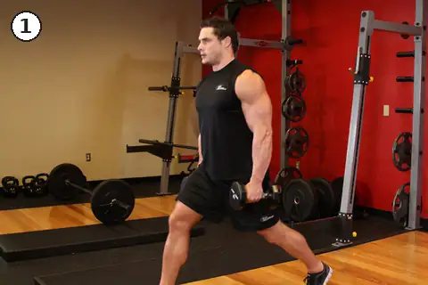

# Ausfallschritt vorwärts im Stand

> Großer Schritt nach vorn, hinteres Knie fast zum Boden, kräftig zurückdrücken.

- **Muskeln/Bereich:** Oberschenkel, Po
- **Equipment:** Kurzhanteln
- **Kategorie:** Beine und Po
- **Erfassung:** Gewicht und Wiederholungen, Steigerung 1 kg
- **Hantel:** zwei Kurzhanteln
- **Pro Seite** ausführen

## Ausführung

- Großer Schritt nach vorn, Fuß zeigt gerade.
- Knie über dem Fuß.
- Kräftig zurück in den Stand.

## Häufige Fehler

- Zu kurzer Schritt.

## Atmung

Ausatmen beim Zurückdrücken.

## Wo du es spürst

Oberschenkel und Po.

## Kommt vor in

- [Kraft C](../ablaeufe/kraft-c.md) (Variante)
