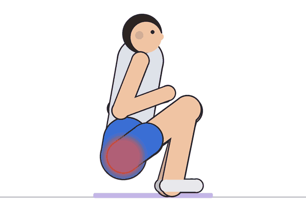

# Girlande (tiefe Hocke)

> Füße etwas breiter, Zehen leicht nach außen, tief in die Hocke. Hände vor der Brust, Ellbogen schieben die Knie sanft auseinander. Fersen ggf. auf eine gerollte Matte.

- **Muskeln/Bereich:** Hüfte, Leiste, Sprunggelenke
- **Equipment:** Körpergewicht
- **Kategorie:** Mobility
- **Erfassung:** Sekunden (Halten)

## Ausführung

- Füße etwas breiter als die Hüfte, Zehen leicht nach außen.
- Tief in die Hocke sinken, Fersen am Boden oder auf einer gerollten Matte.
- Hände vor der Brust, Ellbogen drücken sanft gegen die Knie.
- Brustbein hebt sich, Rücken möglichst lang.

## Häufige Fehler

- Fersen hoch und auf den Zehen balancieren.

## Atmung

Lang in den Bauch und den Beckenboden atmen.

## Wo du es spürst

Öffnung in Hüfte und Leiste, Dehnung in den Waden.

## Kommt vor in

- [Mobility nach Gefühl: Hüfte und Hüftbeuger](../mobility/koerperbereiche.md)
- [Yoga nach Gefühl](../mobility/yoga-baukasten.md)
