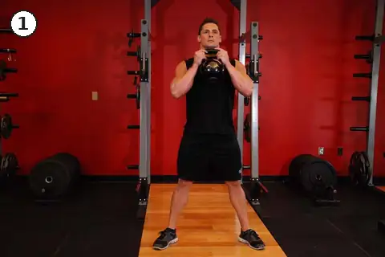

# Goblet Squat

*Hinweis zum Foto: Foto mit Kettlebell, Ablauf mit Kurzhantel gleich.*

> Fersen auf kleine Scheiben, falls die Knöchel steif sind. Unten 1 s Pause.

- **Muskeln/Bereich:** Oberschenkel, Po
- **Equipment:** Kurzhanteln
- **Kategorie:** Beine und Po
- **Erfassung:** Gewicht und Wiederholungen, Steigerung 2 kg

## Ausführung

- Füße schulterbreit, Fußspitzen leicht nach außen.
- Hantel eng vor der Brust, Ellbogen zeigen nach unten.
- Hüfte nach hinten und unten, Knie folgen den Fußspitzen.
- Oberkörper aufrecht, Brust bleibt oben.
- Unten kurz halten, über die ganze Sohle hochdrücken.

## Häufige Fehler

- Knie fallen nach innen.
- Fersen heben ab.
- Rücken rundet unten.

## Atmung

Oben einatmen und Bauch fest, beim Hochdrücken ausatmen.

## Wo du es spürst

Oberschenkel vorn und Po.

## Kommt vor in

- [Kraft B · Beine](../ablaeufe/kraft-b.md)
- [Skill Tiefe Hocke, Stufe 1](../skills/hocke.md)
- [Skill Frontkniebeuge, Stufe 1](../skills/frontsq.md)
