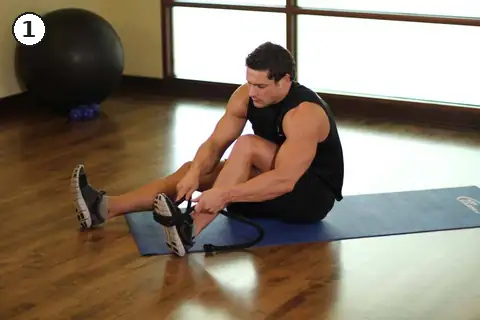

# Leisten-Dehnung im Ausfallschritt

> Breiter Stand, Gewicht auf ein gebeugtes Bein verlagern, anderes Bein gestreckt.

- **Muskeln/Bereich:** Oberschenkel innen
- **Equipment:** Körpergewicht
- **Kategorie:** Mobility
- **Erfassung:** Sekunden (Halten)

## Kommt vor in

- [Mobility nach Gefühl: Leiste und Innenseite](../mobility/koerperbereiche.md)
