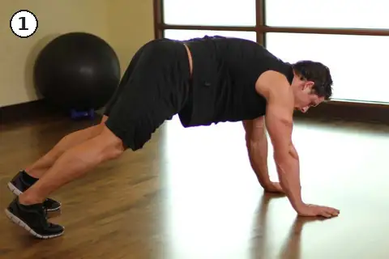

# Groiner

> Aus dem Liegestütz einen Fuß neben die Hand setzen, Hüfte sinken lassen, Seite wechseln.

- **Muskeln/Bereich:** Leiste, Hüfte
- **Equipment:** Körpergewicht
- **Kategorie:** Mobility
- **Erfassung:** Sekunden (Halten)

## Kommt vor in

- [Mobility nach Gefühl: Hüfte und Hüftbeuger](../mobility/koerperbereiche.md)
