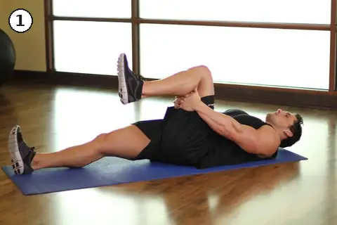

# Beinbeuger 90/90

> Rückenlage, Oberschenkel senkrecht halten, Unterschenkel langsam strecken.

- **Muskeln/Bereich:** Beinbeuger
- **Equipment:** Körpergewicht
- **Kategorie:** Mobility
- **Erfassung:** Sekunden (Halten)
