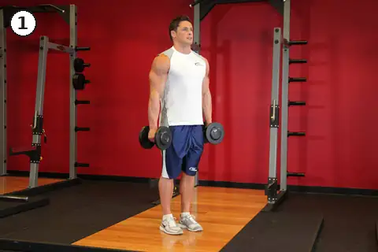

# Hammer Curls

> Daumen zeigen nach oben, Ellbogen am Körper.

- **Muskeln/Bereich:** Bizeps, Unterarme
- **Equipment:** Kurzhanteln
- **Kategorie:** Arme
- **Erfassung:** Gewicht und Wiederholungen, Steigerung 1 kg
- **Hantel:** zwei Kurzhanteln

## Kommt vor in

- [Vorlage Oberkörper Ziehen](../ablaeufe/vorlagen/x-pull.md)
