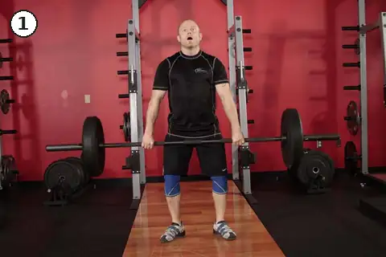

# Umsetzen aus dem Hang

> Stange über den Knien. Hüfte explosiv strecken, Schultern hoch, unter die Stange ziehen und auf den Schultern fangen. Leicht beginnen.

- **Muskeln/Bereich:** Ganzkörper, Schnellkraft
- **Equipment:** Langhantel
- **Kategorie:** Ganzkörper
- **Erfassung:** Gewicht und Wiederholungen, Steigerung 2.5 kg
- **Hantel:** Langhantel
