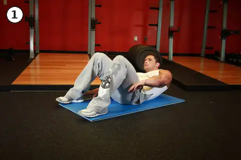

# Fersentippen seitlich

> Schultern leicht abheben, abwechselnd seitlich zur Ferse greifen.

- **Muskeln/Bereich:** Bauch seitlich
- **Equipment:** Körpergewicht
- **Kategorie:** Core
- **Erfassung:** Körpergewicht, Wiederholungen
