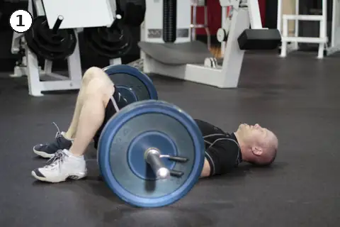

# Hüftbrücke mit Langhantel

> Am Boden, Polster um die Stange. Oben 2 s Po anspannen.

- **Muskeln/Bereich:** Po, Beinbeuger
- **Equipment:** Langhantel
- **Kategorie:** Beine und Po
- **Erfassung:** Gewicht und Wiederholungen, Steigerung 2.5 kg
- **Hantel:** Langhantel

## Ausführung

- Rücken am Boden, Stange mit Polster in der Hüftfalte.
- Füße hüftbreit, Fersen nah am Po.
- Kinn leicht zur Brust, Rippen unten.
- Durch die Fersen drücken, oben Po 2 s anspannen.

## Häufige Fehler

- Oben ins Hohlkreuz.
- Knie fallen nach innen.

## Atmung

Ausatmen beim Hochdrücken.

## Wo du es spürst

Po.

## Kommt vor in

- [Kraft B · Beine](../ablaeufe/kraft-b.md)
- [Skill Kreuzheben, Stufe 1](../skills/kreuzheben.md)
