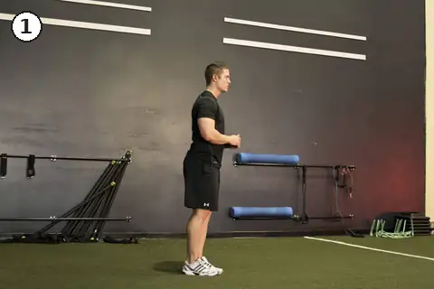

# Hüftkreisen im Stand

> Hände an der Hüfte, Becken langsam in großen Kreisen bewegen.

- **Muskeln/Bereich:** Hüfte
- **Equipment:** Körpergewicht
- **Kategorie:** Mobility
- **Erfassung:** Sekunden (Halten)

## Kommt vor in

- [Mobility nach Gefühl: Hüfte und Hüftbeuger](../mobility/koerperbereiche.md)
