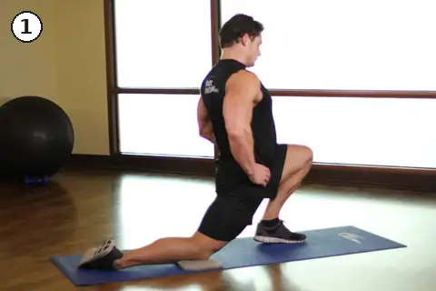
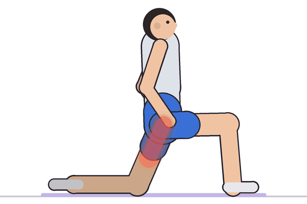

# Hüftbeuger-Dehnung kniend

> Po anspannen, Becken nach vorne schieben. Gegen das lange Sitzen.

- **Muskeln/Bereich:** Hüftbeuger
- **Equipment:** Körpergewicht
- **Kategorie:** Mobility
- **Erfassung:** Sekunden (Halten)

## Ausführung

- Hinteres Knie auf einer weichen Unterlage, vorderer Fuß flach, Knie über dem Sprunggelenk.
- Becken aufrichten: Steißbein leicht nach unten, Bauchnabel zur Wirbelsäule.
- Po des hinteren Beins fest anspannen, dann erst das Becken nach vorn schieben.
- Oberkörper aufrecht, Schultern über den Hüften.
- Für mehr Dehnung den Arm der hinteren Seite nach oben und leicht zur Gegenseite strecken.

## Häufige Fehler

- Ins Hohlkreuz fallen: dann dehnt sich der untere Rücken, nicht der Hüftbeuger.
- Zu weit nach vorn schieben ohne Po-Spannung.
- Vordere Hüfte dreht nach außen weg.

## Atmung

Ruhig weiteratmen. Mit jedem Ausatmen das Becken einen Millimeter weiter schieben.

## Wo du es spürst

Ziehen vorne in der Leiste und am Oberschenkel des hinteren Beins.

## Kommt vor in

- [Mobility-Routine](../ablaeufe/gefuehrt/mob.md)
- [Kondition + Core-Zirkel](../ablaeufe/gefuehrt/circuit.md)
- [Mobility nach Gefühl: Hüfte und Hüftbeuger](../mobility/koerperbereiche.md)
- [Yoga nach Gefühl](../mobility/yoga-baukasten.md)
- [Skill Brücke (Rad), Stufe 1](../skills/bruecke.md)
- [Skill Frontspagat, Stufe 1](../skills/spagat.md)
