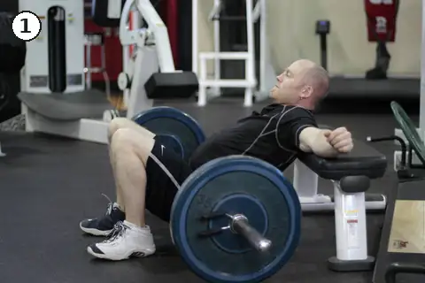

# Hip Thrust an der Bank

> Schulterblätter an der Bankkante, Stange mit Polster auf der Hüfte. Hüfte strecken, oben 1 s Po fest, Kinn zur Brust.

- **Muskeln/Bereich:** Po, Beinbeuger
- **Equipment:** Langhantel, Bank
- **Kategorie:** Beine und Po
- **Erfassung:** Gewicht und Wiederholungen, Steigerung 2.5 kg
- **Hantel:** Langhantel

## Kommt vor in

- [Vorlage Beine und Po](../ablaeufe/vorlagen/x-legs.md)
