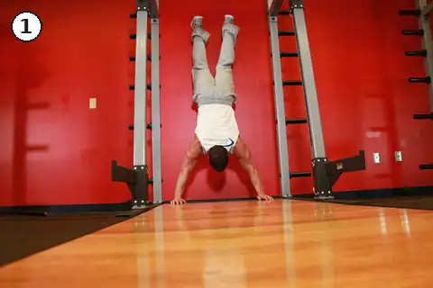

# Handstand-Liegestütze an der Wand

> Fortgeschritten. Im Handstand an der Wand den Kopf kontrolliert zum Kissen senken und hochdrücken.

- **Muskeln/Bereich:** Schultern, Trizeps
- **Equipment:** Körpergewicht, Calisthenics
- **Kategorie:** Schultern
- **Erfassung:** Körpergewicht, Wiederholungen

## Kommt vor in

- [Skill Handstand, Stufe 6](../skills/handstand.md)
- [Skill Handstand-Liegestütz, Stufe 3](../skills/hspu.md)
- [Skill Handstand-Liegestütz, Stufe 4](../skills/hspu.md)
- [Skill Handstand-Liegestütz, Stufe 5](../skills/hspu.md)
- [Skill Überkopfdrücken, Stufe 4](../skills/ohp.md)
