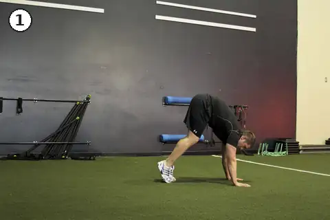

# Inchworm

> Aus dem Stand nach vorn beugen, mit den Händen in den Liegestütz laufen und zurück.

- **Muskeln/Bereich:** Ganzkörper, Rückseite
- **Equipment:** Körpergewicht
- **Kategorie:** Ganzkörper
- **Erfassung:** Körpergewicht, Wiederholungen
