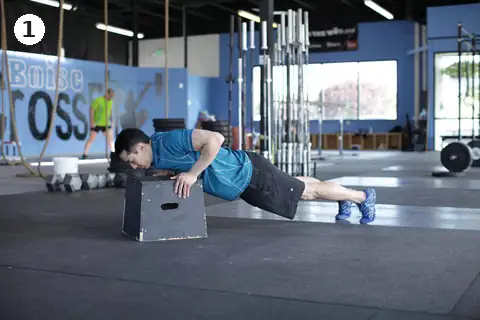

# Liegestütze, Hände erhöht

> Hände auf der Bank, Körper eine Linie. Leichter Einstieg oder Pump am Ende.

- **Muskeln/Bereich:** Brust, Trizeps
- **Equipment:** Bank, Körpergewicht
- **Kategorie:** Brust
- **Erfassung:** Körpergewicht, Wiederholungen
