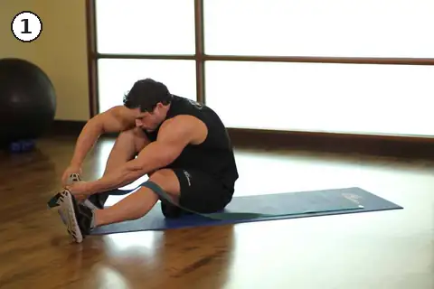

# Po-Dehnung im Stand überkreuzt

> Ein Bein über das andere kreuzen, Hüfte zur Seite schieben, Oberkörper leicht neigen.

- **Muskeln/Bereich:** Po, Hüfte außen
- **Equipment:** Körpergewicht
- **Kategorie:** Mobility
- **Erfassung:** Sekunden (Halten)

## Kommt vor in

- [Mobility nach Gefühl: Po](../mobility/koerperbereiche.md)
