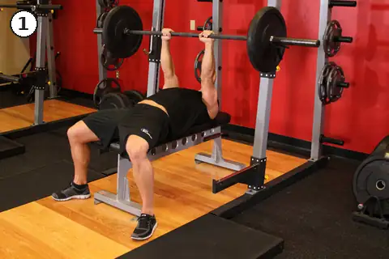

# JM Press

> Mischung aus engem Drücken und French Press: Stange Richtung Kinn absenken, Ellbogen zeigen zu den Füßen, dann hochdrücken.

- **Muskeln/Bereich:** Trizeps
- **Equipment:** SZ-Stange, Bank
- **Kategorie:** Arme
- **Erfassung:** Gewicht und Wiederholungen, Steigerung 2.5 kg
- **Hantel:** SZ-Stange
